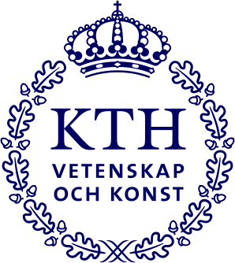

::::: {.sw-hero}

<h1 class="sw-name">Andrea Ruglioni</h1>

::: {.sw-portrait}
{fig-alt="Andrea Ruglioni" .nolightbox}
:::

:::::

::::: {.sw-intro}

::: {.sw-role}
Doctoral candidate in quantitative finance 
EPFL
:::

::: {.sw-lede}
I'm a PhD student in Quantitative Finance at EPFL. My research sits between ML, optimization, and finance -- I enjoy both building new methods and digging into empirical questions in these areas.

Get in touch by [sending me an email](mailto:andrea.ruglioni@epfl.ch).

[[GitHub](https://github.com/Ruglio)]{.sw-link}
[[LinkedIn](https://linkedin.com/in/andrea-ruglioni)]{.sw-link}
[[ORCID](https://orcid.org/0009-0003-5208-5907)]{.sw-link}
[[Google Scholar](https://scholar.google.com/citations?user=3sdazUQAAAAJ&hl=en)]{.sw-link}
[[Email](mailto:andrea.ruglioni@epfl.ch)]{.sw-link}
:::

:::::

::::: {.sw-section}

## Education {.unnumbered .unlisted}

:::: {.sw-rows}

::: {.sw-row}
[2024 – Present]{.sw-when}
[**PhD in Quantitative Finance** EPFL]{.sw-what}
[{.nolightbox height="26"}]{.sw-logo}
:::

::: {.sw-row}
[2022 – 2024]{.sw-when}
[**MSc in Mathematical Engineering** Politecnico di Torino]{.sw-what}
[{.nolightbox}]{.sw-logo}
:::

::: {.sw-row}
[2023 – 2024]{.sw-when}
[**Erasmus+ Exchange Program** KTH Royal Institute of Technology]{.sw-what}
[{.nolightbox}]{.sw-logo}
:::

::: {.sw-row}
[2019 – 2022]{.sw-when}
[**BSc in Mathematics for Engineering** Politecnico di Torino]{.sw-what}
[{.nolightbox}]{.sw-logo}
:::

::::

:::::

::::: {.sw-section}

## Experience {.unnumbered .unlisted}

:::: {.sw-rows}

::: {.sw-row}
[Jan 2026 – Present]{.sw-when}
[**External Research Collaborator, Banking Operations Analysis** Swiss National Bank]{.sw-what}
[{.nolightbox}]{.sw-logo}
:::

::::

:::::

::::: {.sw-section}

## Publications {.unnumbered .unlisted}

::: {#publications}
:::

[All publications &rarr;](publications/index.qmd){.sw-more}

:::::
